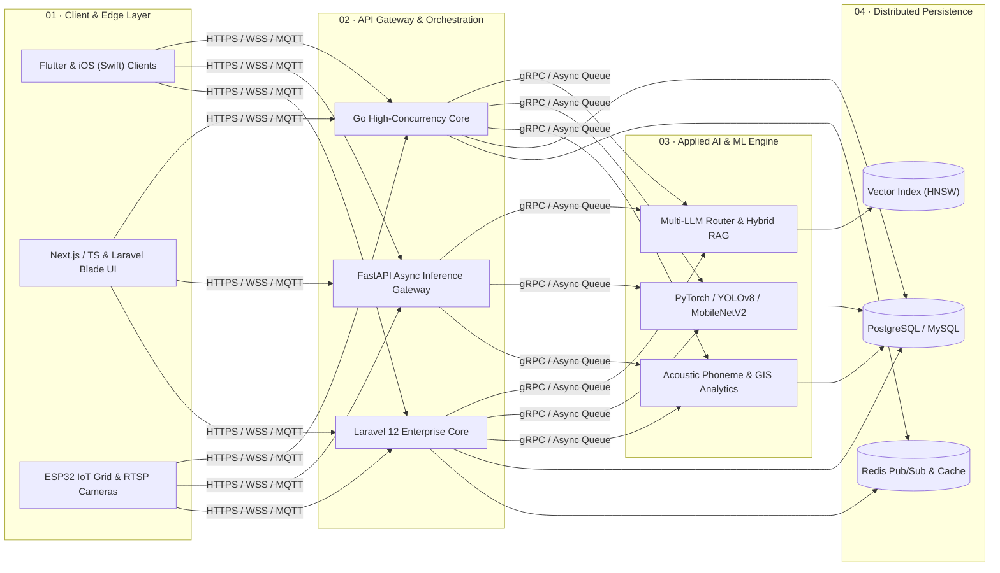

<!-- ===================================================================== -->
<!-- FAJRI ABDURAHMAN GHURRI (FAJRIAG) — EXECUTIVE ENGINEERING PORTFOLIO   -->
<!-- ===================================================================== -->

  
   

  <!-- Animated Typewriter Engineering Headline -->
  
   

  <!-- Primary Action & Contact Badges -->
  

    
    
    
    
  

---

## Executive Summary · Ringkasan Eksekutif

<table>
  <tr>
    <td width="50%" valign="top">
      <h4>🌐 International Profile (EN)</h4>
      

        <strong>Full-Stack Software &amp; AI Systems Engineer</strong> specializing in the end-to-end architecture, development, and deployment of <strong>scalable enterprise web &amp; mobile applications</strong>, <strong>high-concurrency backend microservices</strong>, and <strong>production Artificial Intelligence pipelines</strong>.
      

      

        Proven track record across <strong>66 software repositories</strong> and <strong>11,380+ code contributions</strong> delivering full-lifecycle products—from modern frontend &amp; mobile interfaces (<em>TypeScript, Next.js, React, Tailwind CSS, Flutter, Swift</em>) and resilient backend cores (<em>Go, Laravel 12, FastAPI, Node.js, PostgreSQL, Redis</em>) to enterprise <strong>LLM/RAG platforms, Computer Vision, and Smart City GIS/IoT ecosystems</strong>.
      

    </td>
    <td width="50%" valign="top">
      <h4>🇮🇩 Profil Eksekutif (ID)</h4>
      

        <strong>Full-Stack Software &amp; AI Systems Engineer</strong> dengan spesialisasi pada perancangan arsitektur, pengembangan, dan deployment <strong>aplikasi web &amp; mobile skala enterprise (Full-Stack)</strong>, <strong>backend berkonkurensi tinggi</strong>, serta <strong>sistem Artificial Intelligence produksi</strong>.
      

      

        Berpengalaman membangun <strong>66 repositori sistem</strong> dengan <strong>11.380+ kontribusi kode</strong> yang mencakup pengembangan end-to-end—mulai dari antarmuka frontend &amp; mobile modern (<em>TypeScript, Next.js, React, Flutter, Swift</em>) dan arsitektur backend tangguh (<em>Go, Laravel 12, FastAPI, Node.js, PostgreSQL, Redis</em>) hingga integrasi <strong>pipeline LLM/RAG, Computer Vision, dan Smart City GIS/IoT</strong>.
      

    </td>
  </tr>
</table>

---

## System Architecture Blueprint

  

 

  
<strong>📐 Interactive End-to-End Production Topology (Mermaid Architecture Diagram) — Click to Expand</strong>

   

---

## Core Engineering Domains & Technical Depth

<table>
  <tr>
    <td width="50%" valign="top">
      <h3>1. Full-Stack Web, Enterprise SaaS &amp; Mobile Engineering</h3>
      <ul>
        <li><strong>Modern Frontend &amp; Full-Stack Web:</strong> Architected responsive, high-performance web applications, SaaS dashboards, and digital platforms using <code>TypeScript</code>, <code>Next.js</code>, <code>React</code>, and <code>Laravel 12</code> (<code>Linkswear</code>, <code>Akugrow</code>, <code>SignalCore</code>, <code>token.fajriag.my.id</code>).</li>
        <li><strong>Enterprise ERP, E-Commerce &amp; Billing Systems:</strong> Built end-to-end commercial platforms including multi-tenant office/ERP systems (<code>kantor</code>), e-commerce storefronts (<code>Fajthia-Commerce</code>, <code>vps-store</code>), ISP billing automation (<code>pembayaran-wifi</code>), and Learning Management Systems (<code>LMS</code>, <code>BenkyouHub</code>).</li>
        <li><strong>Cross-Platform &amp; Native Mobile:</strong> Engineered production mobile applications in <code>Flutter (Dart)</code> with Clean Architecture and native iOS applications in <code>Swift</code> (<code>First-Ios-Mobile</code>).</li>
      </ul>
    </td>
    <td width="50%" valign="top">
      <h3>2. High-Concurrency Backend &amp; Distributed Systems</h3>
      <ul>
        <li><strong>Go (Golang) Execution Engines:</strong> Architected concurrent backend services and automated trading/business orchestration cores (<code>AlphaStream</code>, <code>BusinessOS</code>, <code>DAGANG-BOT-ID</code>) utilizing goroutine worker pools, non-blocking I/O, and WebSocket streams.</li>
        <li><strong>Asynchronous Python &amp; Node.js APIs:</strong> Deployed low-latency <code>FastAPI</code>, <code>Flask</code>, and <code>Node.js</code> microservices for real-time data processing, media streaming (<code>KuyNonton</code>, <code>dramabox</code>), and ML inference gateways.</li>
        <li><strong>Database Architecture &amp; Security:</strong> Designed normalized relational schemas (<code>PostgreSQL</code>, <code>MySQL</code>), <code>Redis</code> caching &amp; pub/sub layers, RBAC authentication, and containerized <code>Docker</code> deployments.</li>
      </ul>
    </td>
  </tr>
  <tr>
    <td width="50%" valign="top">
      <h3>3. Generative AI, LLMs &amp; Retrieval Architecture</h3>
      <ul>
        <li><strong>Hybrid RAG Pipelines:</strong> Engineered semantic document intelligence systems (<code>RAG-DocSearch</code>, <code>NeuraSearch</code>) combining dense vector embeddings with lexical retrieval, dynamic chunking, and cross-encoder re-ranking.</li>
        <li><strong>Multi-Model LLM Orchestration:</strong> Built unified AI gateways and agentic workspaces (<code>JriGPT Platform</code>, <code>DASBAORD9ROUTER</code>) with automated provider failover, token streaming, and structured JSON output enforcement.</li>
        <li><strong>Transformer Internals &amp; Auditing:</strong> Implemented custom GPT architectures from scratch in PyTorch (<code>pytorch-gpt-from-scratch</code>) and automated semantic verification engines (<code>SemantiCheck</code>, <code>ai-autopsy-engine</code>).</li>
      </ul>
    </td>
    <td width="50%" valign="top">
      <h3>4. Computer Vision, Speech AI &amp; Smart City GIS/IoT</h3>
      <ul>
        <li><strong>Computer Vision &amp; Speech AI:</strong> Real-time industrial PPE compliance detection using <code>YOLOv8 &amp; OpenCV</code> (<code>Safety-helmet-detector</code>), mobile <code>MobileNetV2</code> agricultural diagnostics, and acoustic pronunciation scoring APIs (<code>Nihongo AI</code>).</li>
        <li><strong>Geospatial &amp; Decision Support Systems:</strong> Built wildfire hotspot prediction and urban spatial planning platforms (<code>Karhutla-Indonesia</code>, <code>SITARU</code>, <code>geo-dcm</code>) plus multi-criteria DSS engines (<code>AHP</code>, <code>TOPSIS</code>, <code>SMART</code>).</li>
        <li><strong>Edge-to-Cloud IoT Telemetry:</strong> Hardware-level firmware in <code>C++ / ESP32</code> streaming sensor telemetry via <code>MQTT</code> and <code>Node-RED</code> into real-time analytical dashboards.</li>
      </ul>
    </td>
  </tr>
</table>

---

## Featured Engineering Case Studies

### 01 · Enterprise Full-Stack SaaS, E-Commerce & Digital Platforms (`BusinessOS`, `Linkswear`, `Kantor`, `Fajthia-Commerce`)
> **Domain:** `Full-Stack Software Engineering` · `Enterprise SaaS & ERP` · `E-Commerce & FinTech`  
> **Architecture Stack:** `TypeScript` · `Next.js / React` · `Laravel 12` · `Go` · `PostgreSQL / MySQL` · `Redis` · `Tailwind CSS`

- **Engineering Challenge:** Modern commercial and enterprise workflows require cohesive end-to-end software systems that combine responsive, high-conversion user interfaces with transactional backend reliability, real-time inventory/billing state, and role-based access control.
- **Architectural Solution:** Engineered a suite of full-stack production platforms spanning enterprise office & operations management (`kantor`, `BusinessOS`), high-traffic digital commerce & automated billing (`Linkswear`, `Fajthia-Commerce`, `vps-store`, `pembayaran-wifi`), and interactive education/media ecosystems (`LMS`, `BenkyouHub`, `KuyNonton`, `dramabox`).
- **Key Technical Capabilities:** Modular full-stack architecture, SSR/CSR frontend optimization, RESTful & WebSocket API integration, automated payment/billing workflows, Redis session/query caching, and multi-role administrative dashboards.

---

### 02 · AlphaStream & High-Concurrency Go Backend Core (`AlphaStream`, `DAGANG-BOT-ID`, `SignalCore`)
> **Domain:** `Distributed Backend` · `Concurrent Systems` · `Real-Time Automation`  
> **Architecture Stack:** `Go (Golang)` · `TypeScript` · `PostgreSQL` · `Redis Pub/Sub` · `REST & WebSockets` · `Docker`

- **Engineering Challenge:** High-throughput event ingestion and automated execution workflows require deterministic low latency and strict concurrency safety without memory bloat.
- **Architectural Solution:** Engineered the core backend services in **Go**, leveraging bounded goroutine worker pools, channel-based pipelines, Redis in-memory state synchronization, and connection pooling paired with TypeScript real-time monitoring interfaces.
- **Key Technical Capabilities:** Sub-50ms internal dispatch overhead, graceful fault recovery, real-time bidirectional WebSocket telemetry, and modular microservice boundaries.

---

### 03 · JriGPT Platform, NeuraSearch & Hybrid RAG Engine (`jrigpt-platform`, `RAG-DocSearch`, `DASBAORD9ROUTER`)
> **Domain:** `Full-Stack AI Platform` · `Enterprise RAG` · `Multi-LLM Gateway`  
> **Architecture Stack:** `Python` · `FastAPI` · `LangChain` · `Vector DB` · `Laravel 12` · `TypeScript` · `Redis`

- **Engineering Challenge:** Standard LLM integrations suffer from hallucination on proprietary enterprise documents, high token latency, and single-provider downtime risks.
- **Architectural Solution:** Designed a full-stack Generative AI platform pairing a **Hybrid Retrieval-Augmented Generation (RAG)** pipeline (dense vector similarity + keyword filtering) with a multi-provider LLM routing gateway and an intuitive full-stack web workspace.
- **Key Technical Capabilities:** Context-window optimization, automated document ingestion & chunk indexing, semantic similarity verification (`SemantiCheck`), and multi-provider API key/account orchestration (`AG_SWITCH_ACCOUNT`).

---

### 04 · Karhutla-Indonesia, SITARU & Smart City Geo-Intelligence (`Karhutla-Indonesia`, `SITARU`, `-dashboard-ecoedu`)
> **Domain:** `Full-Stack GIS` · `Smart City Infrastructure` · `Public-Sector Analytics`  
> **Architecture Stack:** `Python` · `Scikit-learn` · `TypeScript` · `Laravel` · `GeoJSON / GIS` · `MySQL`

- **Engineering Challenge:** Regional governments and environmental agencies require unified full-stack platforms to correlate spatial GIS layers, historical hazard data, and public health/education KPIs in real time.
- **Architectural Solution:** Built integrated geospatial intelligence platforms (`Karhutla-Indonesia`, `SITARU`, `indramayu-analytics-dashboard`) combining Python predictive modeling with interactive TypeScript and Laravel analytical dashboards.
- **Key Technical Capabilities:** Automated spatial risk clustering, interactive polygon/hotspot rendering, multi-criteria decision support (`AHP` / `TOPSIS` / `SMART`), and executive reporting exports.

---

### 05 · Nihongo AI, Cross-Platform Mobile & Industrial Vision Suite (`Nihongo AI`, `Safety-helmet-detector`, `First-Ios-Mobile`)
> **Domain:** `Mobile Engineering (Flutter & iOS)` · `Speech AI` · `Computer Vision`  
> **Architecture Stack:** `Flutter (Dart)` · `Swift (iOS)` · `FastAPI` · `PyTorch` · `YOLOv8` · `MobileNetV2` · `OpenCV`

- **Engineering Challenge:** Delivering responsive mobile user experiences alongside complex deep learning inference (speech phoneme evaluation and real-time video object detection) with minimal latency.
- **Architectural Solution:** Implemented **Clean Architecture** across **Flutter** and native **Swift** mobile clients, decoupled from optimized **FastAPI/PyTorch** inference microservices and lightweight on-device `MobileNetV2` models.
- **Key Technical Capabilities:** Real-time frame-by-frame PPE safety compliance detection (`Safety-helmet-detector`), automated acoustic pronunciation scoring, and reactive mobile state management.

---

## Production Technology Matrix (All-In Full-Stack & AI Ecosystem)

  
   
  
   
  
   
  

 

| Architectural Layer | Production Technologies, Frameworks, Libraries & Engineering Protocols |
| :--- | :--- |
| **01 · Core Languages** |   -00ADD8?style=flat-square&logo=go&logoColor=white)        |
| **02 · Frontend & Modern Web UI** |          `Blade` · `Livewire` · `Inertia.js` · `Filament` · `TanStack Query` · `SSR / ISR / SPA` |
| **03 · Backend & Enterprise Core** |        `Microservices` · `Modular Monolith` · `Clean / Hexagonal Arch` · `Goroutine Worker Pools` |
| **04 · APIs, Real-Time & Security** |     `gRPC` · `Server-Sent Events (SSE)` · `RBAC / ABAC` · `Rate Limiting` · `Payment Gateways (Midtrans / Stripe / Xendit)` |
| **05 · Mobile Engineering** |     `BLoC / Riverpod / Provider` · `Clean Architecture` · `Offline-First (Hive / SQLite)` · `FCM Push Notifications` · `On-Device TFLite / CoreML` |
| **06 · Databases, Cache & ORM** |        `Eloquent` · `GORM` · `SQLAlchemy` · `Vector DB (Qdrant / Chroma / pgvector)` |
| **07 · AI, LLM, RAG & Vision** |      `LangChain` · `LlamaIndex` · `Hybrid RAG` · `Multi-LLM Router (OpenAI / Claude / Gemini / Ollama)` · `YOLOv8` · `MobileNetV2` · `PEFT / LoRA` · `Speech Phoneme AI` |
| **08 · DevOps, Cloud & QA** |         `VPS / Cloud Deployment` · `PyTest / PHPUnit / Jest / Go Test` |
| **09 · Smart City GIS & IoT** |     `Leaflet / Mapbox / GeoJSON` · `PostGIS Spatial Analytics` · `Decision Support Systems (AHP / TOPSIS / SMART)` · `Real-Time Sensor Telemetry` |

---

## Professional Credentials, Licenses & Education

| Credential / Academic Degree | Issuing Institution | Verified Technical Scope |
| :--- | :--- | :--- |
| **IBM Generative AI Engineering Professional Certificate** | **IBM** | Transformer Architectures, Foundation Models, LLM Fine-Tuning (PEFT/LoRA), Retrieval-Augmented Generation (RAG), LangChain Agents & Prompt Engineering |
| **IBM AI Engineering Professional Certificate** | **IBM** | Deep Learning Architectures, CNNs, RNNs, Collaborative Filtering, PyTorch, TensorFlow, Keras & Scalable ML Pipelines |
| **Machine Learning, AI & Statistics Specialization** | **University of Pennsylvania** | Supervised & Unsupervised Learning, Statistical Inference, Probability Modeling, Regression & Algorithmic Optimization |
| **Applied AI & Advanced Prompt Engineering** | **Google** | Production LLM Workflow Design, Structured Output Engineering, Context Optimization & Enterprise AI Automation |
| **B.App.Sc. (D4) in Smart City Information Systems** | **Politeknik Negeri Indramayu** | Full-Stack Software Engineering, Enterprise Information Systems, Geospatial Information Systems (GIS), IoT Networks & Decision Support Systems (DSS) |

---

## GitHub Engineering Telemetry & Contribution Activity

  

---

## Executive Contact & Engineering Inquiries

Available for **Full-Stack Software Engineering (TypeScript / Next.js / Laravel / Go / Flutter)**, **AI & LLM Systems Architecture**, and **Enterprise Technical Consulting**.

- **Direct Email:** [fajriabdurahmanghurri@gmail.com](mailto:fajriabdurahmanghurri@gmail.com)
- **LinkedIn Profile:** [linkedin.com/in/fajri-abdurahman-ghurri](https://linkedin.com/in/fajri-abdurahman-ghurri/)
- **GitHub Portfolio:** [github.com/FAJRIAG](https://github.com/FAJRIAG)
- **Base Location:** Indonesia (Available for Remote Global & On-Site Enterprise Roles)

 

  

