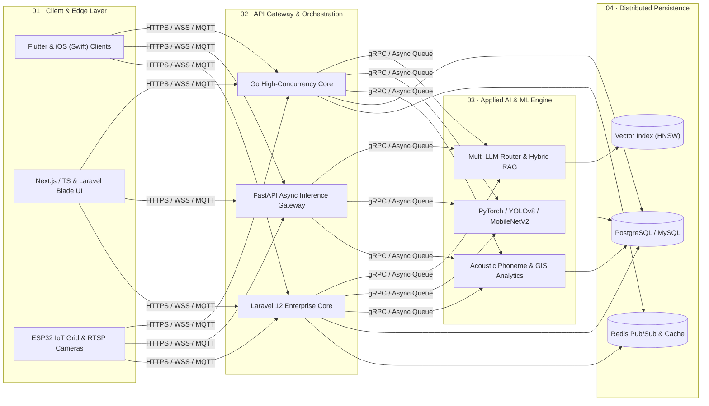

<!-- ===================================================================== -->
<!-- FAJRI ABDURAHMAN GHURRI (FAJRIAG) — EXECUTIVE ENGINEERING PORTFOLIO   -->
<!-- ===================================================================== -->

  
    

  <!-- Primary Action & Contact Badges -->
  

    
    
    
    
  

---

## Executive Summary · Ringkasan Eksekutif

<table>
  <tr>
    <td width="50%" valign="top">
      <h4>🌐 International Profile (EN)</h4>
      

        <strong>AI &amp; Full-Stack Systems Engineer</strong> specializing in the end-to-end architecture, implementation, and deployment of <strong>production Artificial Intelligence pipelines</strong>, <strong>high-concurrency backend microservices</strong>, and <strong>enterprise web/mobile ecosystems</strong>.
      

      

        Proven track record across <strong>65+ software repositories</strong> bridging deep learning and LLM/RAG systems (<em>PyTorch, TensorFlow, LangChain, Hybrid Vector Search</em>) with low-latency distributed backends in <strong>Go</strong> and <strong>Python (FastAPI)</strong>, full-stack enterprise platforms in <strong>TypeScript / Next.js</strong> and <strong>Laravel 12</strong>, cross-platform mobile clients in <strong>Flutter</strong>, and real-time <strong>Smart City GIS/IoT telemetry</strong>.
      

    </td>
    <td width="50%" valign="top">
      <h4>🇮🇩 Profil Eksekutif (ID)</h4>
      

        <strong>AI &amp; Full-Stack Systems Engineer</strong> dengan spesialisasi pada perancangan arsitektur, pengembangan, dan deployment <strong>sistem Artificial Intelligence skala produksi</strong>, <strong>backend berkonkurensi tinggi</strong>, serta <strong>platform enterprise web &amp; mobile</strong>.
      

      

        Berpengalaman membangun lebih dari <strong>65+ repositori sistem</strong> yang mengintegrasikan pipeline LLM/RAG dan Computer Vision (<em>PyTorch, YOLOv8, LangChain</em>) dengan infrastruktur backend <strong>Go (Golang)</strong> dan <strong>FastAPI</strong> berlatensi rendah, aplikasi enterprise <strong>TypeScript / Laravel 12</strong>, aplikasi mobile <strong>Flutter</strong>, serta sistem analitik <strong>Smart City GIS &amp; IoT real-time</strong>.
      

    </td>
  </tr>
</table>

---

## System Architecture Blueprint

  

 

  
<strong>📐 Interactive End-to-End Production Topology (Mermaid Architecture Diagram) — Click to Expand</strong>

   

---

## Core Engineering Domains & Technical Depth

<table>
  <tr>
    <td width="50%" valign="top">
      <h3>1. Generative AI, LLMs &amp; Retrieval Architecture</h3>
      <ul>
        <li><strong>Hybrid RAG Pipelines:</strong> Engineered semantic document intelligence systems (<code>RAG-DocSearch</code>, <code>NeuraSearch</code>) combining dense vector embeddings with lexical retrieval, dynamic chunking, and cross-encoder re-ranking.</li>
        <li><strong>Multi-Model LLM Orchestration:</strong> Built unified AI gateways and agentic workspaces (<code>JriGPT Platform</code>, <code>DASBAORD9ROUTER</code>) with automated provider failover, token streaming, and structured JSON output enforcement.</li>
        <li><strong>Transformer Internals &amp; Auditing:</strong> Implemented custom GPT architectures from scratch in PyTorch (<code>pytorch-gpt-from-scratch</code>) and automated semantic verification engines (<code>SemantiCheck</code>, <code>ai-autopsy-engine</code>).</li>
      </ul>
    </td>
    <td width="50%" valign="top">
      <h3>2. High-Concurrency Backend &amp; Distributed Systems</h3>
      <ul>
        <li><strong>Go (Golang) Execution Engines:</strong> Architected concurrent backend services and automated trading/business orchestration cores (<code>AlphaStream</code>, <code>BusinessOS</code>, <code>DAGANG-BOT-ID</code>) utilizing goroutine worker pools, non-blocking I/O, and WebSocket streams.</li>
        <li><strong>Asynchronous Python Microservices:</strong> Deployed low-latency <code>FastAPI</code> inference servers for real-time speech evaluation, sentiment classification, and computer vision pipelines.</li>
        <li><strong>Enterprise Web &amp; API Security:</strong> Full-lifecycle system design in <code>Laravel 12</code> and <code>TypeScript/Node.js</code> with RBAC, rate-limiting, Redis caching, and transactional integrity.</li>
      </ul>
    </td>
  </tr>
  <tr>
    <td width="50%" valign="top">
      <h3>3. Computer Vision, Speech AI &amp; Deep Learning</h3>
      <ul>
        <li><strong>Industrial Safety Vision (YOLOv8 &amp; OpenCV):</strong> Real-time PPE compliance detection (<code>Safety-helmet-detector</code>) capable of multi-object tracking for helmets and high-visibility vests across live video streams.</li>
        <li><strong>Edge &amp; Mobile Transfer Learning:</strong> Fine-tuned <code>MobileNetV2</code> and custom CNN architectures in PyTorch/TensorFlow for on-device agricultural pathology diagnostics and urban waste classification.</li>
        <li><strong>Acoustic &amp; NLP Intelligence:</strong> Engineered phoneme-level pronunciation scoring APIs (<code>Nihongo AI</code>) and Indonesian public sentiment analytics pipelines.</li>
      </ul>
    </td>
    <td width="50%" valign="top">
      <h3>4. Smart City GIS, Analytics &amp; Embedded IoT</h3>
      <ul>
        <li><strong>Geospatial &amp; Hazard Intelligence:</strong> Built wildfire hotspot prediction and urban spatial planning platforms (<code>Karhutla-Indonesia</code>, <code>SITARU</code>, <code>geo-dcm</code>) integrating machine learning with interactive GIS mapping.</li>
        <li><strong>Executive Decision Support (DSS):</strong> Engineered multi-criteria decision analysis systems implementing <code>AHP</code>, <code>TOPSIS</code>, and <code>SMART</code> algorithms alongside regional KPI dashboards (<code>indramayu-analytics-dashboard</code>).</li>
        <li><strong>Edge-to-Cloud IoT Telemetry:</strong> Hardware-level firmware in <code>C++ / ESP32</code> streaming sensor telemetry via <code>MQTT</code> and <code>Node-RED</code> into time-series monitoring dashboards.</li>
      </ul>
    </td>
  </tr>
</table>

---

## Featured Engineering Case Studies

### 01 · JriGPT Platform, NeuraSearch & Hybrid RAG Engine
> **Domain:** `Generative AI` · `Enterprise RAG` · `LLM Gateway`  
> **Architecture Stack:** `Python` · `FastAPI` · `LangChain` · `Vector DB` · `Laravel 12` · `Redis`

- **Engineering Challenge:** Standard LLM integrations suffer from hallucination on proprietary enterprise documents, high token latency, and single-provider downtime risks.
- **Architectural Solution:** Designed a modular Generative AI platform pairing a **Hybrid Retrieval-Augmented Generation (RAG)** pipeline (dense vector similarity + keyword filtering) with a multi-provider LLM routing layer and asynchronous streaming responses.
- **Key Technical Capabilities:** Context-window optimization, automated document ingestion & chunk indexing, semantic similarity verification (`SemantiCheck`), and role-based enterprise workspace management.

---

### 02 · AlphaStream, BusinessOS & High-Frequency Automation Core
> **Domain:** `Distributed Backend` · `Concurrent Systems` · `Real-Time Automation`  
> **Architecture Stack:** `Go (Golang)` · `PostgreSQL` · `Redis Pub/Sub` · `REST & WebSockets` · `Docker`

- **Engineering Challenge:** High-throughput event ingestion and automated execution workflows require deterministic low latency and strict concurrency safety without memory bloat.
- **Architectural Solution:** Engineered the core backend services in **Go**, leveraging bounded goroutine worker pools, channel-based pipelines, Redis in-memory state synchronization, and connection pooling.
- **Key Technical Capabilities:** Sub-50ms internal dispatch overhead, graceful fault recovery, real-time bidirectional WebSocket telemetry, and modular microservice boundaries.

---

### 03 · Karhutla-Indonesia, SITARU & Smart City Geo-Intelligence
> **Domain:** `Smart City Infrastructure` · `Geospatial AI` · `Public-Sector Analytics`  
> **Architecture Stack:** `Python` · `Scikit-learn` · `TypeScript` · `Laravel` · `GeoJSON / GIS` · `MySQL`

- **Engineering Challenge:** Regional governments and environmental agencies require unified platforms to correlate spatial GIS layers, historical hazard data, and public health/education KPIs in real time.
- **Architectural Solution:** Built integrated geospatial intelligence platforms (`Karhutla-Indonesia`, `SITARU`, `indramayu-analytics-dashboard`) combining Python predictive modeling with interactive TypeScript/Blade analytical dashboards.
- **Key Technical Capabilities:** Automated spatial risk clustering, interactive polygon/hotspot rendering, multi-criteria decision support (`AHP` / `TOPSIS` / `SMART`), and executive reporting exports.

---

### 04 · Nihongo AI, Acoustic Scoring API & Industrial Computer Vision Suite
> **Domain:** `Applied Deep Learning` · `Speech AI` · `Computer Vision` · `Cross-Platform Mobile`  
> **Architecture Stack:** `PyTorch` · `YOLOv8` · `MobileNetV2` · `OpenCV` · `FastAPI` · `Flutter (Clean Architecture)`

- **Engineering Challenge:** Delivering complex deep learning inference (speech phoneme evaluation and real-time video object detection) to end-user mobile and edge devices with minimal latency.
- **Architectural Solution:** Decoupled heavy ML inference into optimized **FastAPI/PyTorch** microservices while implementing **Clean Architecture** in the **Flutter** mobile client and lightweight `MobileNetV2` models for mobile agricultural diagnostics.
- **Key Technical Capabilities:** Real-time frame-by-frame PPE safety compliance detection (`Safety-helmet-detector`), automated acoustic pronunciation scoring, and responsive cross-platform UI state management.

---

## Production Technology Matrix

  
   
  

 

| Architectural Layer | Production Technologies, Frameworks & Protocols |
| :--- | :--- |
| **AI, LLM & Deep Learning** |     `YOLOv8` · `LangChain` · `Hybrid RAG` · `Transformers / PEFT` · `MobileNetV2` · `NLP & Speech AI` |
| **Backend & Distributed Core** |     `Python 3.12+` · `Flask` · `RESTful APIs` · `WebSockets` · `Concurrent Worker Pools` |
| **Frontend, Web & Mobile** |       `Dart` · `Clean Architecture` |
| **Data, Infra & Embedded IoT** |      `Vector Databases` · `Firebase` · `ESP32 / C++` · `MQTT` · `Node-RED` |

---

## Professional Credentials, Licenses & Education

| Credential / Academic Degree | Issuing Institution | Verified Technical Scope |
| :--- | :--- | :--- |
| **IBM Generative AI Engineering Professional Certificate** | **IBM** | Transformer Architectures, Foundation Models, LLM Fine-Tuning (PEFT/LoRA), Retrieval-Augmented Generation (RAG), LangChain Agents & Prompt Engineering |
| **IBM AI Engineering Professional Certificate** | **IBM** | Deep Learning Architectures, CNNs, RNNs, Collaborative Filtering, PyTorch, TensorFlow, Keras & Scalable ML Pipelines |
| **Machine Learning, AI & Statistics Specialization** | **University of Pennsylvania** | Supervised & Unsupervised Learning, Statistical Inference, Probability Modeling, Regression & Algorithmic Optimization |
| **Applied AI & Advanced Prompt Engineering** | **Google** | Production LLM Workflow Design, Structured Output Engineering, Context Optimization & Enterprise AI Automation |
| **B.App.Sc. (D4) in Smart City Information Systems** | **Politeknik Negeri Indramayu** | Software Systems Architecture, Geospatial Information Systems (GIS), IoT Sensor Networks, Decision Support Systems (DSS) & Applied AI |

---

## GitHub Engineering Telemetry & Contribution Activity

  
  

  

---

## Executive Contact & Engineering Inquiries

Available for **AI & LLM Systems Architecture**, **Backend & Full-Stack Engineering (Go / Python / TypeScript / Laravel / Flutter)**, and **Enterprise Technical Consulting**.

- **Direct Email:** [fazryx8@gmail.com](mailto:fazryx8@gmail.com)
- **LinkedIn Profile:** [linkedin.com/in/fajri-abdurahman-ghurri](https://linkedin.com/in/fajri-abdurahman-ghurri/)
- **GitHub Portfolio:** [github.com/FAJRIAG](https://github.com/FAJRIAG)
- **Base Location:** Indonesia (Available for Remote Global & On-Site Enterprise Roles)

 

  

